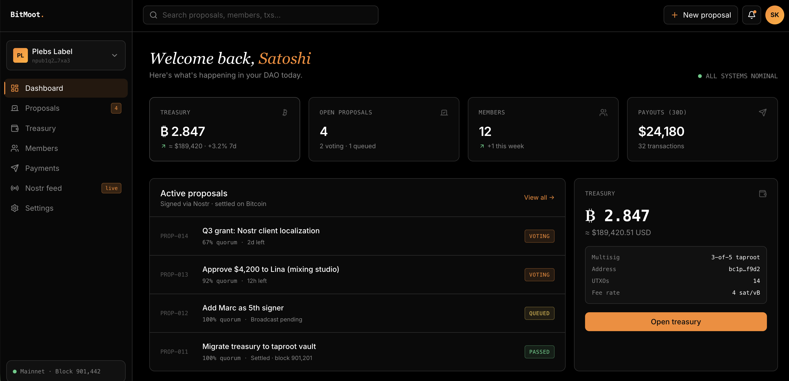

# BitMoot

A DAO platform built entirely on Bitcoin, Nostr, and Lightning.

For:
- Bitcoin/Nostr communities
- Sovereign organization
- Decentralized structures



## Motivation

Many DAOs exists, but real sovereign ones don't.
- Ethereum-dependent: 99% of DAOs require ETH gas, EVM smart contracts, and token bridges. Not self-sovereign.
- No Bitcoin-native option: Bitcoin communities — the ones who care most about sovereignty — have no DAO tooling that matches their values.
- Terrible UX: Seed phrases, gas fees, and wallet popups make onboarding impossible for non-crypto people.

## Sovereign Stack

BitMoot resolves that issue by coupling to sovereign technology for more freedom and ownership:
- Identity: Passkey -> Nostr npub -> Bitcoin wallet
- Governance: Nostr events (multi-relay) · Bitcoin L1 anchoring
- Treasury: Bitcoin Taproot multisig · Miniscript · Timelock backstop
- Execution: Coordinator-optional PSBT · Any member can execute

## Governance design

BitMoot addresses dynamic membership but with a main execution plan.

General members: 
- hold governance token (Spark BTKN tokens)
- vote on proposals via signed Nostr events
- Unlimited, join freely — no on-chain footprint
- Earn governance token for contributions automatically

Council (co-signers):
- Elected by general members, 5-9 seats
- Hold keys in Bitcoin Taproot multisig
- Fixed terms — rotate via one on-chain tx

Governance elects council.

## GitHub Pages deployment

`.github/workflows/deploy.yml` builds and deploys the app on every push to `master` (and on manual dispatch). Requires Node 22.13+ because the Breez SDK and ESLint reject older versions.

1. In **Settings → Pages**, set **Build and deployment → Source** to **GitHub Actions**.
2. Add repository secrets:
   - `VITE_BREEZ_API_KEY`
   - `VITE_PLATFORM_FEE_ADDRESS` (leave unset to disable the platform fee)
3. Set the custom domain in **Settings → Pages → Custom domain**. `public/CNAME` keeps it attached across deployments.
4. Push to `master`.

The Vite base path is auto-detected: a `public/CNAME` file means a custom domain and a `/` base; otherwise it uses the project path `/<repo>/`. An optional repository variable `BASE_PATH` can override this if needed.

`dist/404.html` is generated at build time to preserve deep links such as `/app/proposals` on GitHub Pages.

For a local production check with the same base path:

```sh
yarn build:pages                      # uses public/CNAME => "/"
BASE_PATH=/bitmoot/ yarn build:pages  # simulate a project page
yarn preview
```

## License

GPL